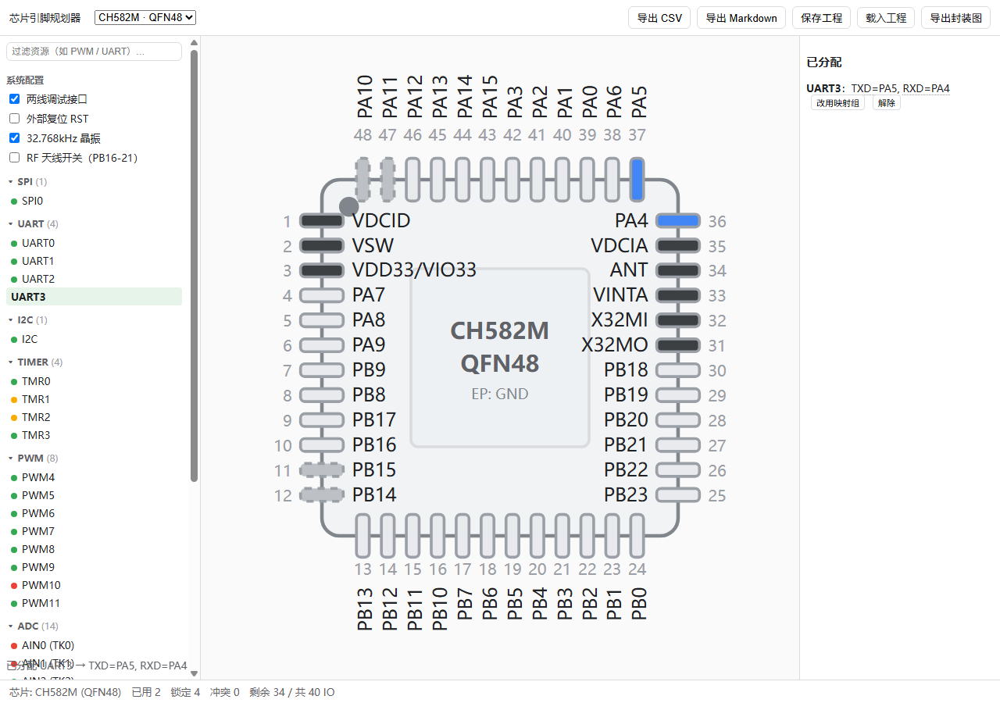
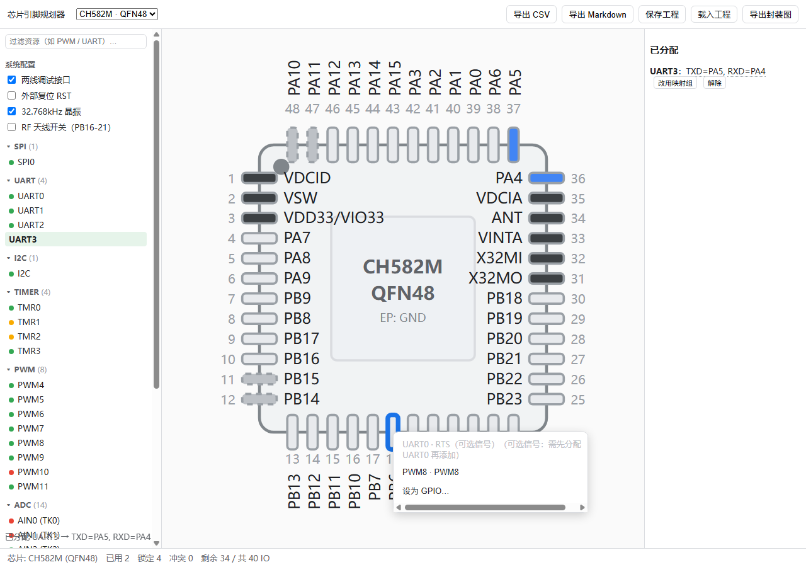
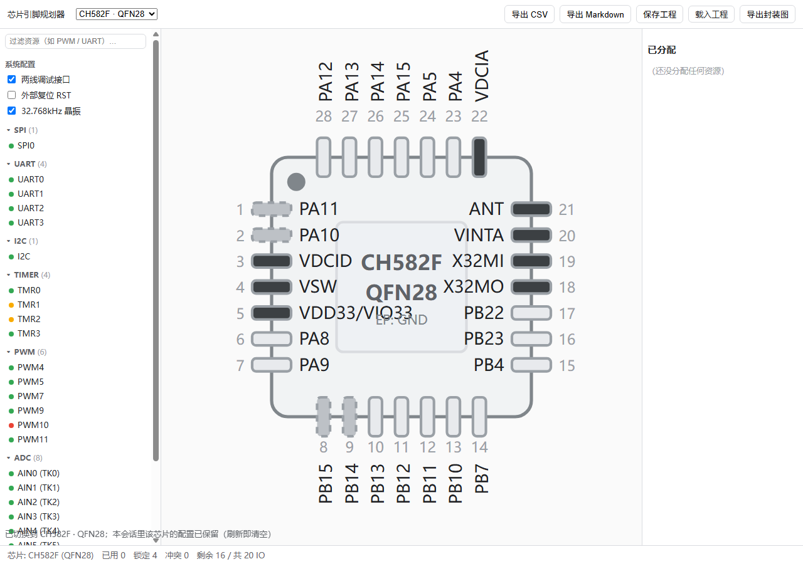

# Chip Pin Planner

[](https://github.com/amadeus-1048596/chip-pin-planner/actions/workflows/ci.yml)
[](https://github.com/amadeus-1048596/chip-pin-planner/releases)
[](https://amadeus-1048596.github.io/chip-pin-planner/)
[](LICENSE)

[中文](README.md) | **English**

A pin-planning sandbox for PCB design: click pins on a package diagram, assign peripheral
functions, catch conflicts, and export a pin list for your schematic.
**No code generation** — it only helps you decide which pin does what.



**Live demo**: <https://amadeus-1048596.github.io/chip-pin-planner/><br>
**Downloads**: [Releases](https://github.com/amadeus-1048596/chip-pin-planner/releases)

## Contents

- [Why](#why)
- [Quick start](#quick-start)
- [5-minute tour](#5-minute-tour)
- [Supported chips](#supported-chips)
- [Project layout](#project-layout)
- [Contributing](#contributing)
- [Rules](#rules)
- [Scope](#scope)
- [FAQ](#faq)
- [Development](#development)
- [License](#license)

## Why

Checking pin multiplexing before drawing a schematic is tedious: mux tables, mapping bits,
and mode restrictions are scattered across a datasheet. This tool puts that data on the
package diagram, so you can see what a pin can do and what it conflicts with.

Currently bundled: WCH CH58x (CH582M / CH582F / CH583M). The data format is vendor-neutral —
adding a chip is one data file plus one manifest line. Contributions and chip requests are welcome.

## Quick start

- **Online (30 s)**: open <https://amadeus-1048596.github.io/chip-pin-planner/> and pick a chip.
- **Offline**: download `chip-pin-planner-vX.Y.zip` from [Releases](https://github.com/amadeus-1048596/chip-pin-planner/releases), extract it, and open `index.html`. No network, no install, no local server.
- **Installer**: download `chip-pin-planner-setup-vX.Y.exe` (per-user, no admin rights). Existing installs can run `update.bat` to upgrade.

Chrome / Edge.

## 5-minute tour

1. **Pick a chip** from the top-bar dropdown, grouped by vendor/series (currently the CH58x family: CH582M / CH582F / CH583M).
2. **Assign pins**, two ways:
   - Click a pin on the package diagram and choose a function. Unavailable options are greyed out with a reason.

     

   - Or click a peripheral in the left panel to auto-assign; click it again to remove.
3. **Check conflicts**: occupied pins are coloured; dots in the left panel show availability — 🟢 default pins free, 🟡 default group occupied (the tool will use the alternate group), 🔴 no landing pin.
4. **Optional signals & modes**: after assigning a peripheral, add MODEM/CS and other optional signals from the right panel; switch host/slave or full/half-duplex for peripherals with modes (e.g. SPI0).
5. **Export**: CSV / Markdown pin list, project JSON, or the package diagram as SVG.
6. **Save your work**: "Save project" downloads a JSON file; loading it switches to the right chip automatically.

Full guide (Chinese): **[docs/user-guide.md](docs/user-guide.md)**.

## Supported chips

| Series | Model | Package | IO | Notes |
|---|---|---|---|---|
| CH58x | CH582M | QFN48 | 40 | Baseline (CH583DS1 V1.9) |
| CH58x | CH582F | QFN28 | 20 | QFN28 subset of CH582M |
| CH58x | CH583M | QFN48 | 40 | CH582M + SPI1 host |



The list is not limited by design: data files are vendor-neutral. Add a chip following
[CONTRIBUTING.md](CONTRIBUTING.md), or open a chip request issue — English is fine.

## Project layout

```text
.
├── index.html                 # entry point; open it directly
├── js/
│   ├── engine/                # chip-agnostic logic (Node-testable)
│   │   ├── model.js           # schema validation, chipId
│   │   ├── availability.js    # conflicts, candidates, assignment, state
│   │   └── exporters.js       # CSV / Markdown / project JSON
│   ├── render/                # hand-written SVG package diagram
│   │   ├── package-svg.js     # quad / dual / dual-split renderer
│   │   └── interactions.js    # zoom, pan
│   ├── app.js                 # UI, state, undo
│   ├── loader.js              # manifest loader
│   └── util.js                # escapeHtml, etc.
├── chips/                     # one data file per chip
│   ├── manifest.js            # list (a new chip must be added here)
│   └── wch-*.js               # chip data
├── tests/                     # engine / fuzz / dist
├── tools/                     # release assembly, datasheet audit
├── installer/                 # Inno Setup script
├── docs/                      # user guide, schema, release notes, design history
├── .github/workflows/         # ci.yml / release.yml
├── update.bat                 # one-click updater for offline builds
└── LICENSE
```

Key design choices:

- **Zero dependencies, no build step**: open `index.html` in a browser; nothing to install or bundle.
- **Engine/data separation**: `js/engine/` knows nothing about a specific chip; chips are data files under `chips/`.
- **file:// first**: no ES modules in the browser; every file has a UMD-lite tail so Node tests can `require()` it.
- **Data is documented**: pins, resources, and constraints live in the data file and are reviewed against the datasheet.

## Contributing

- **Request a chip**: open a [chip request](https://github.com/amadeus-1048596/chip-pin-planner/issues/new/choose). English is fine.
- **Add a chip / fix data**: see [CONTRIBUTING.md](CONTRIBUTING.md). The guide is currently in Chinese; English PRs and issue text are welcome.
- **Maintenance**: `meta.author` in a data file marks its long-term maintainer. Contributors are credited in release notes. After a few high-quality PRs you can become a maintainer.
- **Releases**: merge to master → CI → tag → Pages and Release update automatically; offline users run `update.bat`.

## Rules

1. **Data comes from public datasheets**, checked pin by pin — no guessing. `meta.source` must name the datasheet and version (page numbers are a plus).
2. **A new chip = one data file + one line in `chips/manifest.js`.** A missing line means the chip silently never appears.
3. **Zero dependencies, no build, works from `file://`**; no ES modules in the browser — use the UMD-lite tail.
4. **Chinese UI**; strings entering `innerHTML` must go through `escapeHtml`.
5. **Test first**: PRs must pass CI; one chip per PR, no unrelated changes.
6. **One file per package variant**; record differences in `docs/reference/`.

## Scope

- **Chip data**: currently WCH CH58x (CH582M / CH582F / CH583M). The format is vendor-neutral; more models are welcome.
- **Packages**: the renderer supports `quad` (QFN/LQFP/TQFP), `dual` (SOP/TSSOP/DIP), and `dual-split` (SOT-23 etc.). BGA/WLCSP would need a new renderer branch. See [the schema](docs/chip-data-schema.md).
- **State**: configuration lives in memory only; refreshing clears it. Use "Save project" to keep it.
- **Not included**: code generation, ERC, or auto-routing.
- **Installer**: unsigned; Windows SmartScreen may warn — choose "More info → Run anyway".

## FAQ

- **Does it save my configuration?** No — it lives in memory and is cleared on refresh. Use "Save project" to export JSON.
- **Clicking a pin does nothing?** Dragging more than 8px is treated as panning; click the pad directly. You can also assign from the left panel.
- **How do I update?** Zip/installer users run `update.bat` (it checks the online `version.json`), or download the latest Release. The online version follows the latest Release.
- **Data does not match my datasheet?** Open an issue with the page number/screenshot. Public datasheets are the source of truth; confirmed fixes come with tests.
- **Can I add my own chip?** Yes — see [CONTRIBUTING.md](CONTRIBUTING.md) and [the data schema](docs/chip-data-schema.md).

## Development

```bash
node tests/engine.test.js   # engine + chip data (200 assertions)
node tests/fuzz.js          # 8000 random operations + invariants
node tests/dist.test.js     # release artifacts / zip / installer / update.bat (Windows PowerShell)
```

Release process: [docs/release.md](docs/release.md) (Chinese). Design history: `docs/superpowers/`.

## License

[MIT](LICENSE) © 2026 MeowG

Designed & maintained by **MeowG**.
